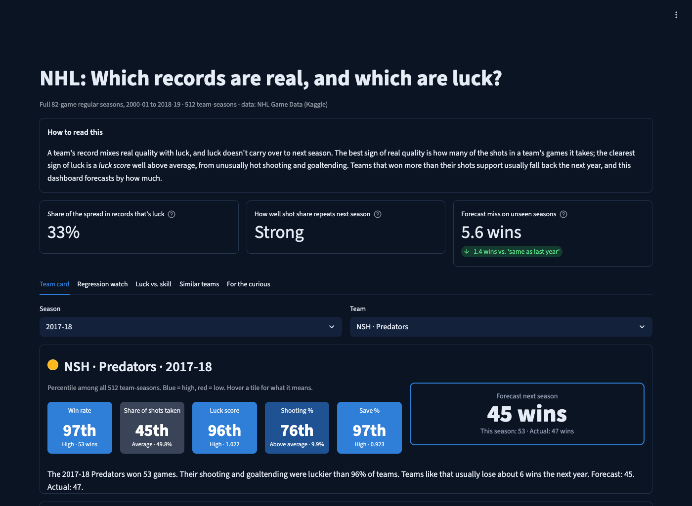
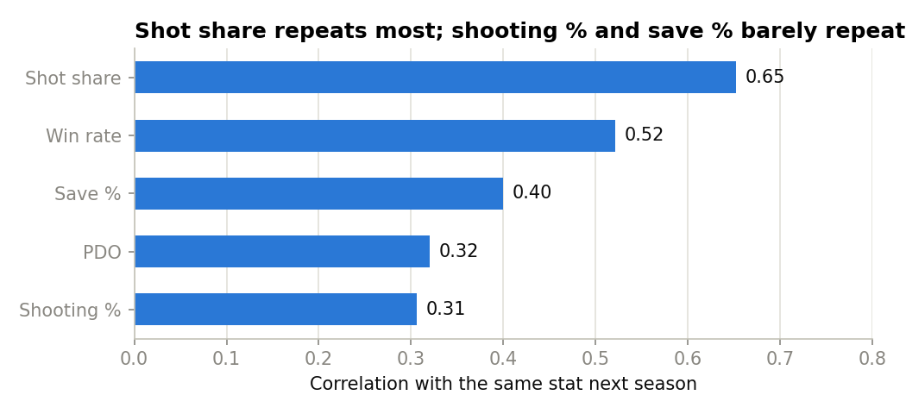
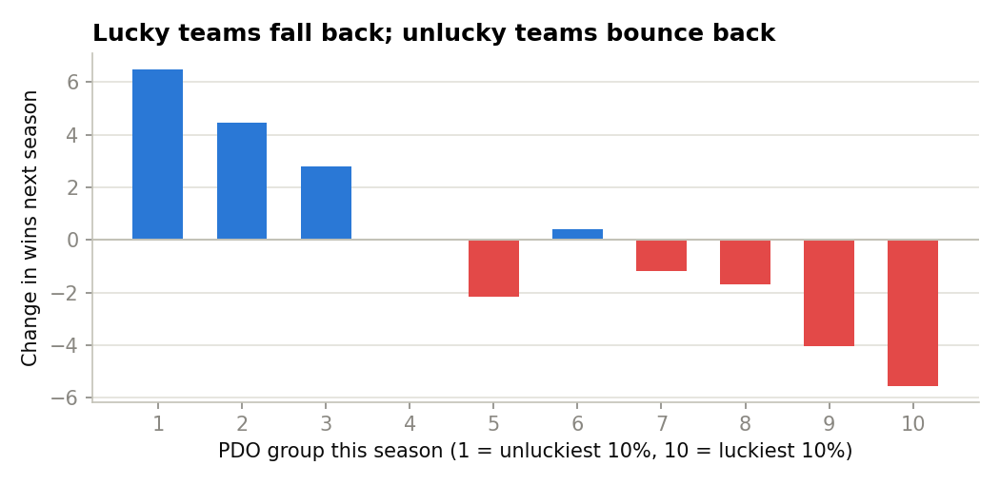

# NHL: Which Records Are Real, and Which Are Luck?

**About a third of the spread in NHL team records is luck, and a two-input model that accounts for it forecasts next season's wins 20% more accurately than "same as last year".**

**Live demo:** _coming soon (Streamlit Community Cloud link)_



[](https://github.com/GabeLR-x/nhl-skill-vs-luck/actions/workflows/tests.yml)


## The question

A team that wins 50 games looks better than one that wins 44. How much of that gap is real quality, and how much is luck that will disappear next season? Using every full 82-game NHL regular season from 2000-01 to 2018-19 (512 team-seasons, 419 back-to-back season pairs), this project separates repeatable skill from luck and uses it to forecast next season, tested on seasons the model never saw.

## Findings

1. **About a third of the spread in records is luck.** A league where every game is a coin flip still spreads 82-game win rates out by 0.055 (standard deviation). The real NHL spread is 0.096, so luck accounts for **33%** of the variance.
2. **Shot share is a better measure of quality than the standings.** A team's share of all shots in its games repeats from one season to the next at **r = 0.65**, more than win rate (**0.52**). Save % (**0.40**), PDO (**0.32**) and shooting % (**0.31**) barely repeat, so they're mostly luck.

   

3. **Lucky teams fall back.** PDO (shooting % + save %) correlates at **r = −0.46** with the next season's change in win rate. The luckiest 10% of teams lost about 5.5 wins the following season; the unluckiest 10% gained about 6.5. Both moved only about halfway back, because a lucky team is usually also a good one.

   

4. **A simple model beats the obvious forecasts.** Trained on seasons through 2016-17 and tested on 2017-18 and 2018-19, a linear regression on win rate + shot share misses next season by **5.6 wins** on average, vs **7.0** for "same as last year" (about 20% less error). Adding PDO doesn't help further. Of the 10 held-out teams it said would fall back most, 9 did.
5. **A logistic regression flags which teams will decline** with 79% accuracy (vs 54% for always guessing the more common outcome). Adding shot share and PDO raises AUC from **0.841** to **0.893**.
6. **Single-game box scores mislead.** Shots alone can't pick a game's winner (50%). The full box score reaches 61%, but its strongest signal is blocked shots, a symptom of already leading rather than a cause of winning. Adding goals jumps accuracy to 80%, which is data leakage: goals decide the winner.

## Method

| Step | What | Where |
|---|---|---|
| Load | Kaggle CSVs into SQLite; removed 2,570 exact duplicate rows in `game.csv` and 5,140 in `game_teams_stats.csv` | `sql/load_data.py` |
| Explore | Does shot volume predict winning, per game and per season? | `notebooks/01_shot_volume.ipynb` |
| Model | Luck simulation, year-to-year repeatability, regression to the mean, linear and logistic regression with a season-based train/test split and baselines | `notebooks/02_skill_vs_luck.ipynb` |
| Shared code | Data loading, rate stats, season pairs and both models, used by the dashboard and the tests | `src/nhl/` |
| SQL | Window functions: running wins (`SUM() OVER`), rolling 10-game shot share, `RANK()` of PDO within each season, `LAG()` for year-over-year change, each checked against pandas | `sql/analysis.sql`, `sql/check_analysis.py` |
| Dashboard | Team card with percentile tiles and a next-season forecast, regression watch, a held-out "was the model right?" check, and a k-nearest-neighbors "similar past teams" lookup | `dashboard/app.py` |
| Tests | pytest for the stats, the season-pair builder and every headline number; a Streamlit AppTest smoke test; CI on every push | `tests/`, `.github/workflows/tests.yml` |

**Key decisions**

- **Regular season only.** Playoff games depend on team quality, so including them would bias the sample.
- **Full 82-game seasons only.** The 2012-13 lockout and 2019-20 COVID seasons are excluded so every season is comparable. The 2004-05 season was cancelled.
- **Train/test split by season, not at random.** A forecast is always built from the past and used on the future, so the model never trains on seasons after the ones it's tested on.
- **Every model is compared against simple baselines** ("same as last year" and "league average"). A model is only useful if it beats them.

## Limitations

- **PDO is a well-known idea in hockey analytics.** This project tests it on 17 seasons and builds a validated forecast on top of it; it doesn't introduce it.
- **Regression to the mean can't see real improvement.** The model forecast the 2017-18 Lightning (54 wins) to drop to 46. In 2018-19 they won 62, tied for the most in NHL history. A model built on "extremes fade" will always miss a team that is genuinely getting better.
- The luck estimate treats every game as a 50/50 coin flip, ignoring home ice and overtime/shootout rules.
- The forecast test set is small: 61 team-season pairs.
- Every shot counts the same. There is no shot-quality (expected goals) data.

## Run it yourself

```bash
python -m venv .venv
source .venv/bin/activate
pip install -r requirements-dev.txt   # or requirements.txt for just the dashboard

streamlit run dashboard/app.py        # dashboard; builds its data from the CSVs, no database needed
python sql/load_data.py               # builds nhl.db for the notebooks and SQL queries
python sql/check_analysis.py          # runs the window-function queries and checks them against pandas
python -m pytest                      # tests
```

The three CSVs this project uses are included in `data/`. The full dataset is [NHL Game Data](https://www.kaggle.com/datasets/martinellis/nhl-game-data) by Martin Ellis on Kaggle. Deployment steps are in [DEPLOY.md](DEPLOY.md).

## Repo structure

```
data/         game.csv, game_teams_stats.csv, team_info.csv, table_relationships.JPG
src/nhl/      shared analysis code (data, features, pairs, models, cards)
sql/          load_data.py, analysis.sql, check_analysis.py
notebooks/    01_shot_volume.ipynb, 02_skill_vs_luck.ipynb
dashboard/    app.py (Streamlit)
tests/        pytest + Streamlit AppTest
figures/      charts used in this README
```
